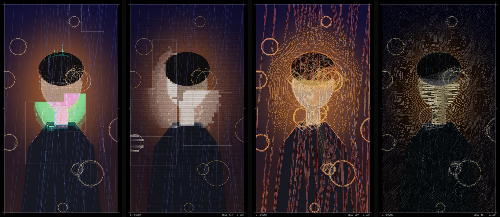

# AndyKit

**Open source OpenFX plugin for DaVinci Resolve Studio** that turns the edges of your footage into points, shapes and lines — with temporal pixel memory, contour fields, dither print, glitch and a beat pulse.



*The four demo looks: Lines · Lines Gray · Circles · Dither*

- Works on the **Edit** page (as a clip effect) and the **Color** page (as a node).
- **macOS** (Apple Silicon + Intel), **Windows** and **Linux** builds from every release.
- Every parameter is keyframable; every frame renders the same whether you play, scrub or render on a farm.
- MIT licensed.

## Install

Download the zip for your system from [Releases](../../releases), then follow [`docs/INSTALL.txt`](docs/INSTALL.txt):

| System  | Copy `AndyKit.ofx.bundle` to          |
|---------|----------------------------------------|
| macOS   | `/Library/OFX/Plugins/`                |
| Windows | `C:\Program Files\Common Files\OFX\Plugins\` |
| Linux   | `/usr/OFX/Plugins/`                    |

On macOS run once: `sudo xattr -dr com.apple.quarantine /Library/OFX/Plugins/AndyKit.ofx.bundle`

In Resolve: **Effects → OpenFX → Filters → ANDYTHEFILMMAKER → AndyKit**.

## Presets — save your own looks as files

The four built-in looks are **demos**: starting points to learn the controls, not finished styles.

Your own looks are plain-text **`.andykit`** files you can keep anywhere — in your project, in an `#ASSETS` folder, on a shared drive — instead of duplicating clips or effects in Resolve:

1. Set the effect the way you like it.
2. In **Presets** type a **Preset Name**, optionally a **Preset File** path, and press **Save Preset to File**.
   With no path, the file goes to `Documents/AndyKit Presets/`.
3. To reuse it: put the path in **Preset File** and press **Load Preset from File**.

Every `.andykit` file inside `Documents/AndyKit Presets/` (sub-folders too) also appears in the **Preset** menu, marked `*`, the next time Resolve starts. The files are readable and editable by hand:

```
format = andykit-preset
version = 1
name = Club Night
density = 80
colorMode = Hybrid
pixelMemory = true
...
```

Missing parameters fall back to defaults, so presets keep working when new controls are added.

## Section switches

Every section starts with an **Enable** checkbox (Points, Connections, Motion, Subject Focus, Pixel Memory, Texture, Contours, Grid, Dither, Beat Pulse). Turning one off removes that layer and greys out its controls — handy for building a look one layer at a time.

## What it does

| Group | Controls |
|---|---|
| **Presets** | Demo looks + your `.andykit` presets, Apply, Save / Load preset file |
| **General** | Seed, colour mode (source / palette / mono / duotone / hybrid), 8 palettes, 12 blend modes, source & overlay opacity, artwork frame, labels |
| **Motion** | Glitch, drift, pulse, orbit — amount and speed |
| **Points** | Density, edge threshold, point radius, node shapes (bracket, square, circle, cross, diamond, mixed), size range, hierarchy, variation, halo circles |
| **Connections** | Contour-following, nearest, radial, orthogonal; strength, edge confidence, weight, hub network |
| **Subject** | Emphasize or isolate the area with the strongest detail |
| **Pixel Memory** | Temporal feedback in drifting windows — feedback, glyphs or archive style |
| **Contours** | Topographic iso-lines or flow streamlines |
| **Grid / Dither / Texture** | Modular grid, Atkinson / Floyd-Steinberg / Bayer dither print, scanlines, grain |
| **Rhythm** | BPM-locked pulse driving shapes, lines and glitch (OpenFX effects don't receive audio) |

## Build from source

Requirements: CMake ≥ 3.20 and a C++17 compiler. The OpenFX SDK (1.5.1) and stb are fetched automatically.

```sh
cmake -S . -B build -DCMAKE_BUILD_TYPE=Release
cmake --build build -j
# → build/bundle/AndyKit.ofx.bundle
```

macOS universal: add `-DCMAKE_OSX_ARCHITECTURES="arm64;x86_64"`.

### Testing without Resolve

```sh
# render the engine on a still (12 frames so motion and memory evolve)
./build/ak_render tests/assets/portrait.png out.png --preset "Demo - Circles" --frames 12 density=80 --save-preset my.andykit

# load the real plugin bundle in a minimal OpenFX host (needs expat): -DAK_BUILD_TESTS=ON
./build/smoke_host build/bundle tests/assets/portrait.png out --frames 4 --preset 2
```

## Project layout

```
src/core/     engine — no OpenFX dependency (analysis, drawing, layers, presets)
src/ofx/      OpenFX plugin wrapper
tools/        ak_render command-line renderer
tests/ofxhost minimal OpenFX host for CI smoke tests
```

Parameters are declared once in `src/core/Params.h` (`AK_PARAM_LIST`) and drive the engine, the plugin UI and the CLI.

## Roadmap

- GPU rendering (Metal / CUDA / OpenCL)
- Real-time preview optimisations for 4K timelines
- More looks; preset import/export as text

## Credits

Created by **Andrea Pio Molinari — ANDYTHEFILMMAKER**.

Uses the [OpenFX SDK](https://github.com/AcademySoftwareFoundation/openfx) (BSD-3-Clause) and [stb](https://github.com/nothings/stb) (public domain / MIT) — see [THIRD_PARTY.md](THIRD_PARTY.md).

---

### In italiano

AndyKit è un plugin OpenFX gratuito e open source per DaVinci Resolve Studio: trasforma i bordi del girato in punti, forme e linee, con memoria dei pixel, contour, dither, glitch e pulsazione a tempo. Si installa copiando `AndyKit.ofx.bundle` nella cartella dei plugin OFX (vedi tabella sopra) e si trova in **Effects → OpenFX → ANDYTHEFILMMAKER → AndyKit**.
